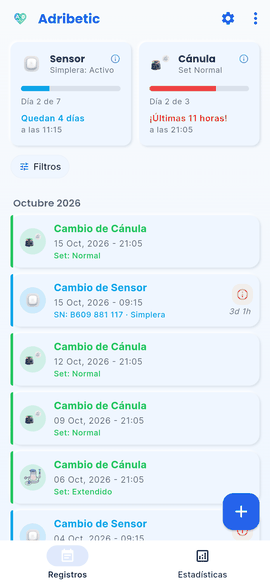
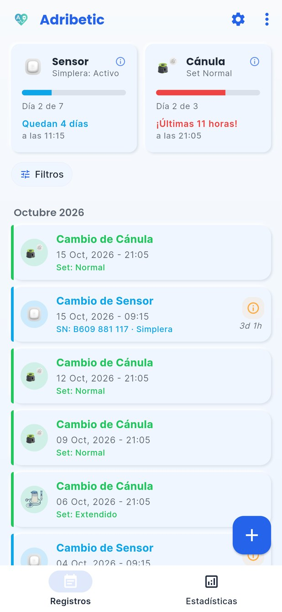
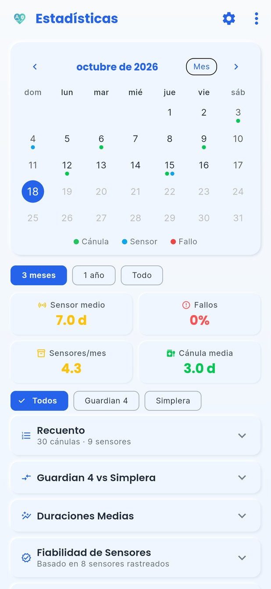
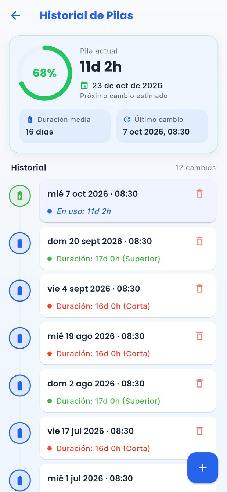
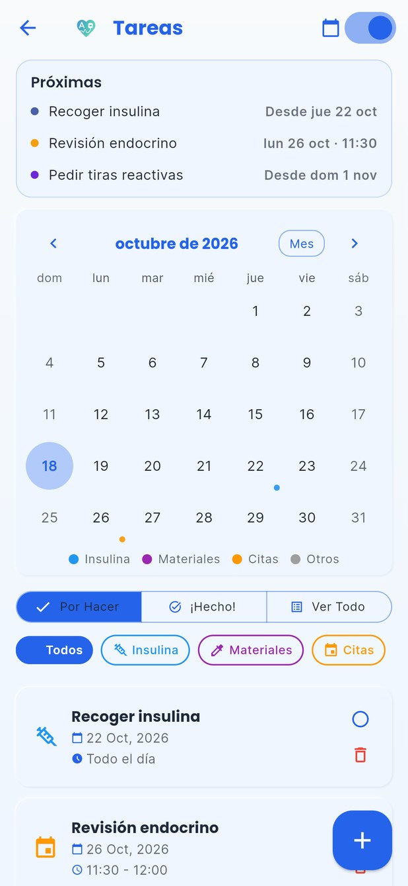
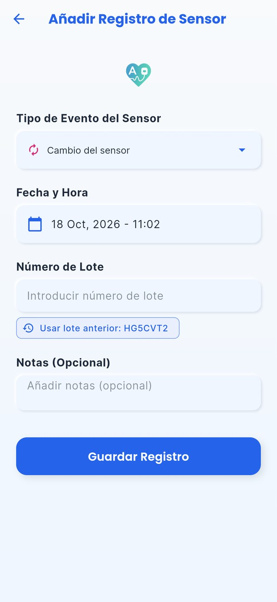
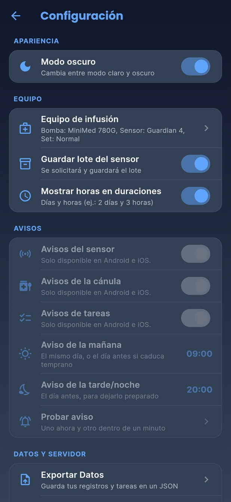
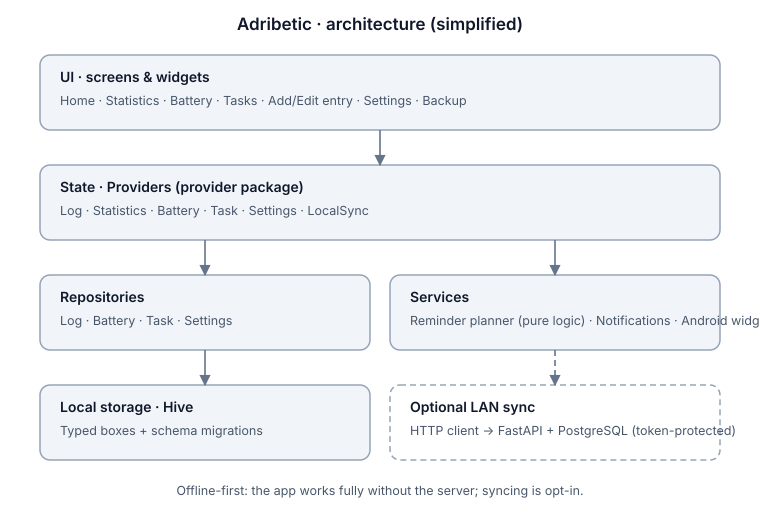

# Adribetic

A personal Flutter app that keeps track of infusion-set, CGM-sensor and pump-battery changes, with reminders and stats.

I live with type 1 diabetes and use an insulin pump. I built Adribetic for myself, to stop keeping those dates in notes and my head, and I've been using and extending it since May 2025. The screenshots below use made-up sample data.

> **Status:** private, in daily use. This repository is a showcase (screenshots, architecture, project numbers and one code excerpt). The full source is not public and there are no public builds.

## Screenshots

| Log | Statistics | Pump battery |
|---|---|---|
|  |  |  |

| Tasks | New entry | Settings (dark) |
|---|---|---|
|  |  |  |

Every screen also exists in dark mode (`media/*_dark.jpg`). The UI is in Spanish.

## Features

- **Change log** for infusion sets, CGM sensors (Guardian 4, Simplera Sync) and pump batteries, with filters and one card per sensor cycle.
- **Progress bars** that show how much time is left for the current sensor and infusion set.
- **Statistics:** monthly calendar, averages, failure rate, usage by time of day and a side-by-side comparison of the two sensor models.
- **Pump battery history** with average duration and an estimate of the next change.
- **Tasks** (insulin pick-up, test strips, appointments) with optional "repeat every N days".
- **Reminders** timed to when each sensor or set expires (on mobile; not available on the desktop build).
- **Android home-screen widget** with the time left for sensor and set.
- **Backup:** JSON export/import, and optional sync with a small self-hosted server on the local network.
- Light and dark themes.

## Tech stack

- Flutter / Dart (SDK ^3.7), `provider` for state management
- Hive (local, offline-first storage) with versioned schema migrations
- `flutter_local_notifications`, `home_widget`, `table_calendar`
- Optional sync server: Python, FastAPI, PostgreSQL

## Architecture

The UI talks to providers, providers to repositories, repositories to typed Hive boxes. The reminder logic is pure Dart with no plugin dependencies, which makes it easy to test; [`sample/reminder_planner.dart`](sample/reminder_planner.dart) is that module, shown for illustration only.

## Project in numbers

Taken from the private repository's history on 18 Oct 2026:

| | |
|---|---|
| First commit → latest | 18 May 2025 → 18 Oct 2026 |
| Commits | 188 (on 29 different days), 16 merged pull requests |
| Dart code in `lib/` | 56 files, about 17,900 non-blank lines |
| Tests | 116 test cases in 15 files (`flutter test`), plus a pre-commit hook that runs them |
| Activity | 42 commits in the first month, then bursts around Apr 2026 and Sep–Oct 2026 |

I haven't tracked hours, so I don't claim any.

## How it was built

I wrote the app iteratively, using it myself and fixing what annoyed me. Part of the later work (the Sep–Oct 2026 redesign) was done with AI coding assistance (Claude Code), through pull requests that I reviewed and tested on my own phone.

## What I learned

- Designing an offline-first app: local storage as the source of truth, with sync as an optional extra, including tracking deletions so they survive a sync.
- Evolving a Hive schema without losing data (the schema went through four versions, with migrations for each).
- Keeping business rules (when to warn about an expiring sensor) in pure functions so they can be unit-tested without the UI or the notification plugin.
- Making a data-heavy mobile UI readable: compact cards, collapsible sections and consistent light/dark themes.

## Not a medical device

Adribetic is a personal logbook. It does not measure glucose, does not control or communicate with any pump or sensor, and gives no medical advice or dosing guidance. Do not use it to make treatment decisions. Medtronic, MiniMed, Guardian and Simplera are trademarks of their respective owners; this project is not affiliated with or endorsed by them.

## License

© 2025–2026 Adrián (Adrifib). All rights reserved. The contents of this repository are shown for viewing only; no permission is granted to copy, modify, distribute or use them.
